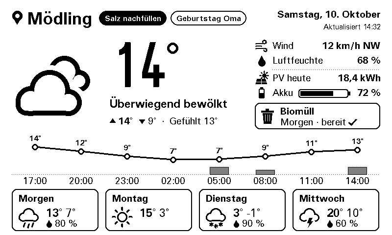
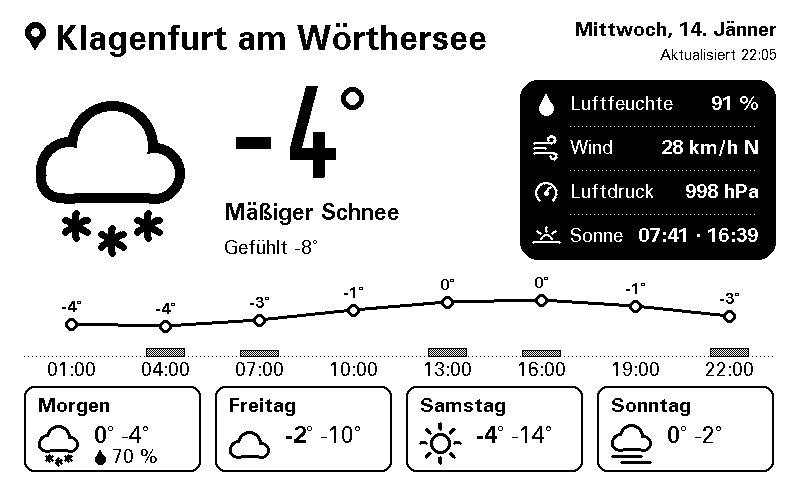

# e-Paper-Wetterstation

Wetteranzeige für einen **NodeMCU ESP8266** mit **Waveshare 7.5" e-Paper V2** (800 × 480, schwarz/weiß).
Wetterdaten kommen von [OpenWeatherMap](https://openweathermap.org), dazu optional **Home Assistant**:
nächste Müllabfuhr, PV-Ertrag und Akku, Hinweise wie „Salz nachfüllen“ oder Geburtstage.


- Modernes Layout: große Temperatur, Info-Spalte, 24-Stunden-Verlauf mit Niederschlag, 4-Tage-Vorhersage
- Schwarz heißt Handlungsbedarf: Müll-Karte und Hinweis-Chips werden nur dann invertiert
- Volle Umlaute: ä ö ü Ä Ö Ü ß ° · – auch in Ortsnamen und Wetterbeschreibungen („Mäßiger Schnee“, „Jänner“)
- Wettericons als Vektorgrafik, scharf in jeder Größe
- Nachtpause, optional Deep Sleep für Akkubetrieb, verständliche Fehlermeldungen am Display

 

Links: Müll schon draußen, ein Info-Chip. Rechts: ohne Home Assistant, mit klassischer Info-Kachel.

## Hardware

| Teil | Hinweis |
|------|---------|
| NodeMCU 1.0 (ESP-12E), ESP8266 | Board „NodeMCU 1.0 (ESP-12E Module)“ |
| Waveshare e-Paper Driver HAT Rev2.1 | Schalter **Display Config = B**, **Interface Config = 0** |
| Waveshare 7.5" e-Paper **V2**, 800 × 480, s/w (GDEW075T7) | getestet |
| Waveshare 7.5" e-Paper **(B) V2**, 800 × 480, s/w/rot (GDEW075Z08) | in `config.h` wählbar, ungetestet |

### Verkabelung NodeMCU → HAT

| HAT  | NodeMCU | Hinweis |
|------|---------|---------|
| VCC  | **3V3** | nicht VIN: bei 5 V erkennt der Pegelwandler die 3,3-V-Signale nicht zuverlässig |
| GND  | GND     | |
| DIN  | D7      | Hardware-SPI MOSI |
| CLK  | D5      | Hardware-SPI SCK |
| CS   | **D3**  | nicht D8: der HAT zieht CS hoch, auf D8 bootet der ESP8266 nicht |
| DC   | D2      | |
| RST  | D1      | |
| BUSY | D6      | |

Für **Deep Sleep** (Akkubetrieb) zusätzlich **D0 mit RST** verbinden.

## Einrichtung

1. **Arduino IDE** mit ESP8266-Boardpaket (getestet mit 3.1.2) installieren.
2. Bibliotheken über den Bibliotheksverwalter installieren:
   **GxEPD2**, **Adafruit GFX Library**, **U8g2_for_Adafruit_GFX**, **ArduinoJson** (Version 7).
3. Kostenlosen API-Key bei [OpenWeatherMap](https://home.openweathermap.org/api_keys) anlegen
   (ein neuer Key wird erst nach bis zu 2 Stunden aktiv).
4. Im Ordner `Wetterstation/` die Datei `secrets_example.h` nach **`secrets.h`** kopieren und ausfüllen:
   WLAN, API-Key, Ort und angezeigter Name. `secrets.h` steht in `.gitignore` und landet nie auf GitHub.
5. `Wetterstation/Wetterstation.ino` öffnen, Board „NodeMCU 1.0 (ESP-12E Module)“ wählen, hochladen.

Der serielle Monitor (115200 Baud) zeigt, was passiert. Befehle: `u` = sofort aktualisieren,
`d` = Demo-Bild mit Beispieldaten, `h` = nur Home Assistant abfragen (z. B. um die Firewall zu prüfen).

### Netzwerk

Der ESP8266 kann nur **2,4 GHz** und **WPA2** (kein WPA3, kein 5 GHz). Hängt er in einem eigenen
IoT-Netz, muss die Firewall Folgendes erlauben:

| Ziel | Port | Wofür |
|------|------|-------|
| DNS-Server | 53 UDP/TCP | Namensauflösung |
| `at.pool.ntp.org`, `pool.ntp.org` | 123 UDP | Uhrzeit |
| `api.openweathermap.org` | 80 TCP | Wetterdaten |
| Home Assistant, z. B. `192.168.1.10` | 8123 TCP | nur mit Home-Assistant-Anbindung |

## Einstellungen (`config.h`)

| Einstellung | Standard | Bedeutung |
|-------------|----------|-----------|
| `PANEL_V2_BW` / `PANEL_V2_3C` | `PANEL_V2_BW` | Display-Variante |
| `DISPLAY_ROTATION` | `0` | `2` = um 180° gedreht |
| `TIMEZONE` | MEZ/MESZ | Zeitzone mit Sommerzeit |
| `UPDATE_INTERVAL_MIN` | `30` | Aktualisierung, ausgerichtet auf :00 und :30 |
| `NIGHT_PAUSE_START` / `_END` | `0` / `5` | keine Aktualisierung zwischen 0 und 5 Uhr |
| `USE_DEEP_SLEEP` | `false` | `true` nur mit Brücke D0 → RST |
| `DEMO_MODE` | `false` | Beispieldaten ohne WLAN, zum Testen des Displays |

## Home Assistant (optional)

Empfohlen ist ein **Template-Helfer**, der Müll, PV/Akku und Hinweise in Home Assistant aufbereitet;
die Station holt ihn mit einer einzigen Anfrage. Anleitung und fertiges Template:
**[docs/home_assistant.md](docs/home_assistant.md)**.

In `secrets.h`:

```cpp
#define HA_URL            "http://192.168.1.10:8123"  // mit http:// und IP, ".local" geht nicht
#define HA_TOKEN          "..."                       // Profil -> Sicherheit -> Langlebige Zugriffstoken
#define HA_DISPLAY_ENTITY "sensor.eink_display"
```

Ohne Template-Sensor lassen sich auch bis zu vier einzelne Entities in der Info-Kachel anzeigen
(`HA_ENTITIES`, Beispiele in `secrets_example.h`), z. B. ein Abfallkalender mit
`{"Müll", "calendar.abfallkalender", "message", "start_time"}`.

Bei einem ungültigen Token fragt die Station bis zum Neustart nicht mehr nach, damit Home Assistant
die IP-Adresse nicht sperrt.

## Umlaute

Die Standard-Schriften von Adafruit GFX kennen nur ASCII, deshalb fehlten früher Umlaute. Hier werden
U8g2-Schriften mit vollem Latin-1-Zeichensatz verwendet, und alle Texte laufen durch `utf8Sanitize()`:

- UTF-8 (Normalfall) wird korrekt dargestellt.
- Dateien, die versehentlich als „ANSI“ (Windows-1252) gespeichert wurden, werden erkannt und umgewandelt.
- Zeichen außerhalb von Latin-1 werden ersetzt (č → c, ő → ö, „ “ → ", – → -), statt zu verschwinden.

Am besten trotzdem alle Dateien als UTF-8 speichern (Arduino IDE und VS Code machen das standardmäßig).

## Fehlermeldungen am Display

| Meldung | Lösung |
|---------|--------|
| Einrichtung nötig | `secrets.h` mit echten Werten füllen |
| Keine WLAN-Verbindung | SSID/Passwort prüfen, 2,4 GHz und WPA2 nötig |
| API-Key ungültig | Key prüfen; neue Keys brauchen bis zu 2 Stunden |
| Ort nicht gefunden | `LOCATION_QUERY` als „Ort,AT“ schreiben oder Koordinaten verwenden |

Kurze Aussetzer überbrückt die Station: Das letzte Wetterbild bleibt stehen, eine Meldung kommt erst nach
ca. 30 Minuten ohne Erfolg.

## Projektaufbau

| Datei | Inhalt |
|-------|--------|
| `Wetterstation/Wetterstation.ino` | Ablauf: WLAN, Zeit, Abruf, Zeichnen, Schlafen |
| `config.h`, `secrets_example.h` | Einstellungen |
| `owm_client.*`, `ha_client.*`, `home_format.cpp` | Datenabruf OpenWeatherMap / Home Assistant |
| `forecast.*` | Tageswerte aus der 3-Stunden-Vorhersage |
| `layout.*`, `icons.*`, `draw_utils.*` | Bildschirmaufbau und Grafik |
| `fonts.*` | Schriften im Flash, erzeugt mit `tools/make_fonts.py` |
| `text_de.*` | deutsche Texte, UTF-8-Behandlung |
| `legacy/` | ursprüngliche esp-open-sdk-Firmware (nicht mehr gepflegt) |

## Herkunft und Lizenz

Basiert auf dem [weatherdisplay](https://github.com/andrei7c4/weatherdisplay) von Andrei Mehilainen
(MIT-Lizenz, siehe `LICENSE.txt`); dessen Firmware liegt unverändert in `legacy/`. Die Arduino-Version
wurde neu geschrieben. Schriften: FreeUniversal und Logisoso aus [U8g2](https://github.com/olikraus/u8g2)
(SIL Open Font License).
