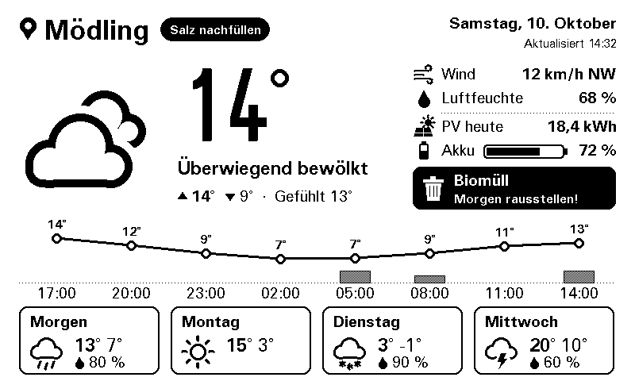

# Home Assistant für die Wetterstation

Die Station holt alle Home-Assistant-Daten aus **einer** Entity: dem Template-Helfer **„Eink Display“**.
Er bereitet Müll, Energie und Hinweise auf; was wann wichtig ist, entscheidet Home Assistant, die
Station zeichnet nur. So lässt sich die Anzeige ändern, ohne neu zu flashen.



## So sieht es aus

| Bereich | Inhalt | Hervorhebung |
|---------|--------|--------------|
| Kopfzeile | Hinweis-Chips, z. B. „Salz nachfüllen“, „Geburtstag Oma“ | schwarz = Aufgabe (Priorität ≥ 2), umrandet = Info |
| Info-Spalte | Wind, Luftfeuchte, PV heute, Akku als Balken | fehlen Energiedaten, stehen dort Luftdruck und Sonne |
| Müll-Karte | Müllart + Termin („Morgen“, „Donnerstag“, „Do, 22.10.“) | **schwarz**, wenn heute/morgen Abholung und noch nicht rausgestellt; mit Haken, wenn erledigt |

## 1. Helfer anlegen

*Einstellungen → Geräte & Dienste → Helfer → Helfer erstellen → Template → Template-Sensor*

- **Name:** `Eink Display` (ergibt `sensor.eink_display`)
- **Zustandstemplate:** Inhalt von [`eink_display_template.jinja`](eink_display_template.jinja)
- Einheit, Geräteklasse usw. leer lassen

Die Entity-IDs im Template sind Beispiele (Müllsensor, Müllkalender, `input_boolean.muell_rausgestellt`,
PV-Ertrag, Akku, Hinweise) und müssen an die eigene Installation angepasst werden; die Vorschau im
Dialog zeigt sofort das Ergebnis. Fehlende Entities stören nicht, der jeweilige Teil bleibt leer.
Tipp: Eine angepasste Kopie als `docs/*.local.jinja` ablegen, die ist in `.gitignore` eingetragen.

Der Zustand ist kompaktes JSON (Home Assistant erlaubt maximal 255 Zeichen), z. B.:

```json
{"w":{"d":"2026-10-15","k":"Biomüll","t":5,"o":1},"e":{"pv":6.1,"b":17},"n":[[2,"Salz nachfüllen"]]}
```

| Schlüssel | Bedeutung |
|-----------|-----------|
| `w.d`, `w.k` | Datum und Art der nächsten Müllabholung |
| `w.t` | Tage bis zur Abholung (0 = heute) |
| `w.o` | rausgestellt: `1` ja, `0` nein, `-1` unbekannt |
| `e.pv`, `e.b` | PV-Ertrag heute in kWh, Akku-Ladestand in % (`null` = unbekannt) |
| `n` | bis zu 3 Hinweise als `[Priorität, Text]`; 1 = Info, 2 = Aufgabe, 3 = dringend |

## 2. Station konfigurieren

In `Wetterstation/secrets.h`:

```cpp
#define HA_URL            "http://192.168.1.10:8123"
#define HA_TOKEN          "..."   // Profil -> Sicherheit -> Langlebige Zugriffstoken
#define HA_DISPLAY_ENTITY "sensor.eink_display"
```

## Hinweise

- **Mehrere Abholungen pro Woche:** Die Karte zeigt immer die nächste Abholung; mehrere Müllarten am
  selben Tag erscheinen zusammen („Papier, Restmüll“). Am Abholtag zählt der heutige Termin nur bis
  12 Uhr, danach springt die Karte zur nächsten Abholung, auch wenn die schon am nächsten Tag ist.
- **„Rausgestellt“** zählt nur, wenn der Schalter seit dem Vortag der angezeigten Abholung geändert
  wurde, z. B. von einer Erinnerungs-Automation, die ihn am Vortag auf `off` setzt und per
  „Erledigt“-Knopf auf `on`. Ein alter Stand von der letzten Abholung wird ignoriert.
- Die Anzeige ist ein **Stand alle 30 Minuten**: kurzlebige Ereignisse (z. B. „Waschmaschine fertig“)
  nur verwenden, wenn der Zustand bis zum Ausräumen bestehen bleibt.
- Neue Hinweise: im Template eine Zeile nach dem Muster
  `` ergänzen.
  Texte kurz halten (die Kopfzeile hat Platz für etwa zwei Chips).
- Firewall: Die Station braucht Zugriff auf Home Assistant über TCP 8123.
